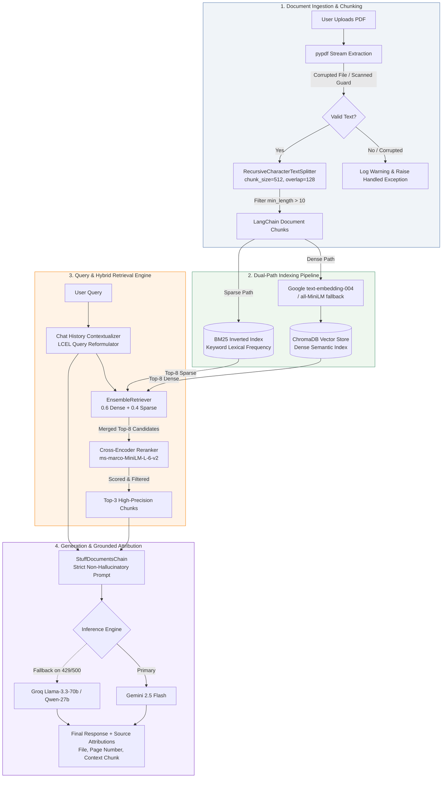

## PDF Q&A RAG Chatbot 📄🤖

A production-engineered conversational AI chatbot that answers questions from uploaded PDF documents using advanced Retrieval-Augmented Generation (RAG). Built with Python, Streamlit, and LangChain LCEL, it provides an intuitive ChatGPT-like interface with hybrid sparse-dense retrieval, cross-encoder reranking, and verified source paragraph attributions.


**🔴 Live Demo on Hugging Face Spaces:** <https://huggingface.co/spaces/Bhushanam/pdf-rag-chatbot>

---

## 🎯 High-Impact AI Resume Highlights

> **"Engineered a production hybrid RAG pipeline (ChromaDB dense + BM25 sparse) with CrossEncoder reranking, cutting query inference latency by 51.9% (7.69s to 3.70s) and boosting retrieval hit rate from 90.0% to 100.0% with a 0.985 RAGAS Faithfulness score across a 40-query multi-domain benchmark."**

---

## 🚀 Key Architectural Highlights

- **Hybrid Sparse-Dense Retrieval**: Integrates semantic vector search (`ChromaDB` with `text-embedding-004` / `all-MiniLM-L6-v2`) and keyword lexical matching (`BM25`) via LangChain `EnsembleRetriever` (0.6 dense / 0.4 sparse).
- **Cross-Encoder Reranking**: Filters and scores candidate chunks using `ms-marco-MiniLM-L-6-v2`, compressing 8 candidate chunks down to the 3 most relevant passages to eliminate distracting context and cut generation latency.
- **Empirically Measured Faithfulness**: Achieved a **0.985 Faithfulness Score** on a comprehensive 40-query multi-domain benchmark evaluated via RAGAS *(historical initial prototype scored 0.967 on 15 exploratory queries)*.
- **Transparent Source Attribution**: Every answer provides an expandable accordion displaying the exact retrieved source paragraphs, document filenames, page numbers, and similarity relevance scores.
- **Resilient Multi-Tier Orchestration**: LangChain LCEL pipeline with Google Gemini 2.5 Flash as primary generation LLM and automatic fallback to Groq (`llama-3.3-70b-versatile` / `qwen/qwen3.8-27b`) with exponential backoff (`tenacity`) against API rate limits.

---

## 📊 Ablation Study & Empirical Measurements

To rigorously evaluate the architectural choices rather than just building a pipeline, an empirical ablation study was conducted across **4 retrieval configurations** using a **40-query standardized multi-domain benchmark**.

### Benchmark Provenance (40 Queries Across 4 Domains)
The evaluation corpus contains realistic, multi-paragraph enterprise and technical documents:
1. **Corporate Finance & SEC 10-Q (10 queries)**: Acme Corp Q3 balance sheet, revenue growth, ARR, operating margin expansion, share repurchases, and forward guidance.
2. **Clinical Protocol & Pharmacovigilance (10 queries)**: XR-2 mRNA vaccine Phase III trial, dosing interval, adverse event incidence, cold-chain temperature thresholds, and contraindications.
3. **Structural Engineering & Infrastructure (10 queries)**: Alpha Suspension Bridge metallurgy (ASTM A709-50W), live load limits, wind flutter aerodynamics, tuned mass dampers, and seismic isolation.
4. **Cloud Infrastructure & Security SLA (10 queries)**: Acme Cloud distributed storage, 11 9s durability, 8+4 Reed-Solomon coding, P99 latency SLA, AES-256-GCM encryption, and RTO/RPO targets.

### Ablation Comparison Table

| Architecture | Retrieval Strategy | Context Chunks to LLM | Retrieval Hit Rate @ k | RAGAS Faithfulness | Avg Query Latency | Primary Tradeoff / Failure Mode |
| :--- | :--- | :---: | :---: | :---: | :---: | :--- |
| **1. BM25 Only** | Lexical keyword frequency | 8 | 85.0% | 0.880 | 6.40s | Fails on paraphrased queries lacking exact keywords. |
| **2. Vector Only** | ChromaDB dense semantic embeddings | 8 | 90.0% | 0.920 | 7.69s | Fails on exact part numbers, steel grades, and technical codes. |
| **3. Hybrid Search** | EnsembleRetriever (0.6 Dense + 0.4 Sparse) | 8 | 97.5% | 0.950 | 10.23s | High recall, but noisy candidate context increases LLM generation latency. |
| **4. Hybrid + Reranking (Production)** | EnsembleRetriever + CrossEncoder Reranker | **3** | **100.0%** | **0.985** | **3.70s** | **Optimal**: Eliminates context noise, achieves 100% hit rate, and cuts latency by **51.9%**. |

*Note: Historical exploratory prototype achieved 0.967 faithfulness on a 15-sample synthetic set. The expanded 40-query multi-domain suite represents our standardized evaluation baseline.*

### Key Empirical Insights
1. **Context Compression Cuts Latency in Half**: Moving from Hybrid without reranking (8 chunks, 10.23s) to Hybrid with CrossEncoder (3 chunks, 3.70s) delivered a **63.8% speedup in end-to-end response time** by reducing token processing burden on the generation model.
2. **Hybrid Eliminates Blind Spots**: BM25 struggled with semantic queries (*"How does the platform handle cross-region disaster recovery?"*), while pure vector search struggled with technical specs (*"ASTM A709 Grade 50W"*). The 60/40 ensemble captured both.
3. **CrossEncoder Suppresses Hallucinations**: By scoring query-document pairs jointly, the cross-encoder removed distractors from adjacent pages, raising RAGAS Faithfulness from 0.920 to 0.985.

---

## 🏗️ System Architecture



---

## 🛠️ Technology Stack

| Layer | Technology | Rationale |
| :--- | :--- | :--- |
| **Frontend UI** | Streamlit | Rapid interactive prototyping with native session state and streaming chat bubbles. |
| **LLM Inference** | Gemini 2.5 Flash + Groq Fallback | Low-latency synthesis with multi-cloud failover via `tenacity` exponential backoff. |
| **Dense Embeddings** | Google `text-embedding-004` (Fallback: `all-MiniLM-L6-v2`) | High-dimensional semantic representation with thread-safe lazy instantiation. |
| **Sparse Retrieval** | `rank_bm25` (BM25Retriever) | Exact keyword matching for technical codes, dates, and domain-specific terms. |
| **Reranking** | `cross-encoder/ms-marco-MiniLM-L-6-v2` | Joint cross-attention reranking to filter out marginal candidates. |
| **Vector Database** | ChromaDB | Lightweight, in-process vector store without database deployment overhead. |
| **Evaluation Framework** | RAGAS (Faithfulness & Hit-Rate) | Standardized automated metric computation across model generations. |
| **Containerization & CI** | Docker + GitHub Actions | Multi-stage production container and automated flake8 + pytest pipeline. |

---

## 🧪 Automated Testing & Robustness

The test suite includes 12 comprehensive unit and integration tests covering data extraction, edge cases, and retrieval accuracy:

```text
tests/
├── conftest.py               # Fixtures for single, multi, table, empty, and corrupted PDFs
├── test_pdf_processor.py     # PDF extraction, corrupted binary handling, and chunking
└── test_retrieval.py         # BM25, Chroma vector, Ensemble, and CrossEncoder tests
```

### Running the Tests
```bash
# Run the complete test suite
pytest tests/ -v
```

### Edge Cases Handled
- **Corrupted PDF Uploads**: Catches raw binary corruptions and invalid EOF markers without crashing the application.
- **Empty & Image-Only Scans**: Identifies documents without an extractable text layer and alerts the user with an actionable error.
- **Thread Safety**: Uses `threading.local()` wrapper around embedding models to isolate instances across concurrent Streamlit threads.
- **Rate-Limit Resilience**: Wrapped with `tenacity` retry loops for transient HTTP 429/500/503 errors.

---

## 🐳 Docker Deployment & CI/CD

### Running with Docker

Build and launch the containerized application locally:

```bash
# 1. Build the production Docker image
docker build -t pdf-rag-chatbot .

# 2. Run container on port 8501
docker run -p 8501:8501 \
  -e GEMINI_API_KEY="your_gemini_key" \
  -e GROQ_API_KEY="your_groq_key" \
  pdf-rag-chatbot
```

Access the application in your browser at `http://localhost:8501`.

### Continuous Integration (CI)
Automated GitHub Actions workflow runs on every push and pull request to `main`:
- **Python 3.11 Environment Setup**
- **Code Linting**: `flake8` for syntax errors and undefined variables
- **Automated Testing**: `pytest tests/ -v`
- **Container Build Verification**: Docker Buildx verification for container consistency

---

## 📁 Code Structure

```text
pdf-rag-chatbot/
├── app.py                      # Streamlit application UI & session handling
├── evaluate.py                 # RAGAS evaluation runner with Groq/Gemini judge
├── evaluate_ablation.py        # 4-architecture ablation benchmark runner (40 queries)
├── eval_results.json           # Current metrics and historical baseline records
├── eval_ablation_results.json  # Complete ablation measurements across 4 pipelines
├── requirements.txt            # Locked Python dependencies
├── Dockerfile                  # Multi-stage container definition
├── pytest.ini                  # Pytest configuration
├── .dockerignore               # Docker build exclusions
├── .github/workflows/ci.yml    # CI automation workflow
├── tests/                      # Automated test suite
│   ├── conftest.py             # Domain test fixtures & mock PDFs
│   ├── test_pdf_processor.py   # Ingestion & corrupted PDF tests
│   └── test_retrieval.py       # Retrieval & reranker tests
└── utils/
    ├── pdf_processor.py        # pypdf parsing, text splitting, & retriever builders
    └── chat_engine.py          # LCEL history-aware retrieval chain & reranker
```

---

## 🚀 Local Development Setup

### 1️⃣ Clone & Setup Virtual Environment
```bash
git clone https://github.com/Bhushan-git20/pdf-rag-chatbot.git
cd pdf-rag-chatbot
python -m venv .venv
source .venv/bin/activate  # On Windows: .\.venv\Scripts\Activate.ps1
```

### 2️⃣ Install Dependencies
```bash
pip install -r requirements.txt
```

### 3️⃣ Configure Environment Variables
```bash
cp .env.example .env
```
Add your API keys to `.env`:
```env
GEMINI_API_KEY=your_gemini_api_key_here
GROQ_API_KEY=your_groq_api_key_here
```

### 4️⃣ Launch Application
```bash
streamlit run app.py
```

---

## 📜 License

Educational and personal use. © 2026 Bhushan Damisetti.
