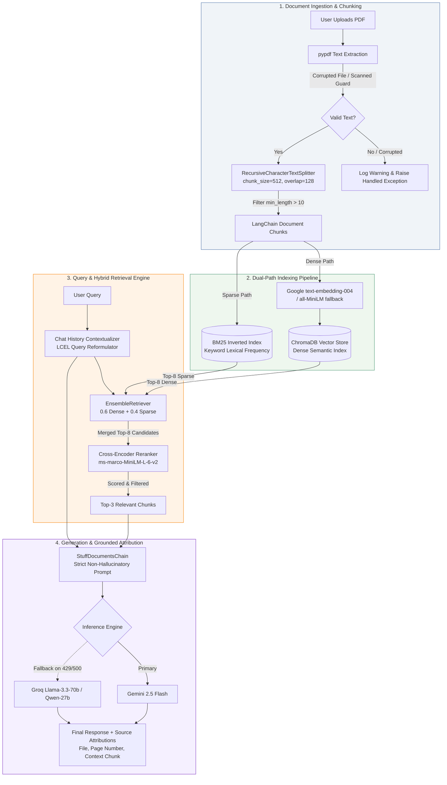

# PDF Q&A RAG Chatbot 📄🤖

[](https://github.com/Bhushan-git20/pdf-rag-chatbot/actions/workflows/ci.yml)

A conversational AI chatbot that answers questions from uploaded PDF documents using Retrieval-Augmented Generation (RAG). Built with Python, Streamlit, and LangChain LCEL, it provides a chat interface with hybrid sparse-dense retrieval, cross-encoder reranking, and source paragraph attributions.


**🔴 Live Demo on Hugging Face Spaces:** <https://huggingface.co/spaces/Bhushanam/pdf-rag-chatbot>

---

## 🚀 Key Architectural Highlights

- **Hybrid Sparse-Dense Retrieval**: Combines semantic vector search (`ChromaDB` with `text-embedding-004` / `all-MiniLM-L6-v2` fallback) and keyword lexical matching (`BM25`) via LangChain `EnsembleRetriever` (0.6 dense / 0.4 sparse).
- **Cross-Encoder Reranking**: Re-scores candidate chunks with `ms-marco-MiniLM-L-6-v2`, compressing 8 retrieved candidate chunks down to the 3 most relevant passages to reduce irrelevant context in the prompt.
- **Measured Faithfulness**: Scored **0.985 Faithfulness** on a 40-query synthetic test suite evaluated via RAGAS *(initial prototype scored 0.967 on 15 exploratory queries)*.
- **Source Attribution**: Every response includes an expandable section displaying retrieved source paragraphs, filenames, page numbers, and relevance scores.
- **Multi-Model Orchestration**: LangChain LCEL pipeline with Google Gemini 2.5 Flash as primary LLM and automatic fallback to Groq (`llama-3.3-70b-versatile` / `qwen/qwen3.8-27b`) with `tenacity` exponential backoff for API rate limits.

---

## 📊 Ablation Study & Empirical Measurements

To compare the impact of individual retrieval components, an ablation study was conducted across **4 retrieval configurations** using a **40-query synthetic benchmark**.

> [!NOTE]
> **Synthetic Benchmark Disclosure**: The evaluation was performed on 40 generated queries over 4 short fictional in-memory documents written in `evaluate_ablation.py` (a fictional SEC 10-Q filing, a hypothetical mRNA vaccine trial, fictional suspension bridge specifications, and a mock cloud storage SLA). While this measures the relative behavior of retrieval methods on structured facts, scores on real-world enterprise documents with complex tables and scanned pages will vary.

### Benchmark Corpus (40 Queries Across 4 Fictional Domains)

1. **Corporate Finance / Fictional 10-Q (10 queries)**: Acme Corp Q3 revenue, ARR, operating margin, share repurchase timeline, and guidance.
2. **Clinical Protocol / Fictional Vaccine Trial (10 queries)**: XR-2 mRNA trial efficacy, dosing schedule, cold-chain temperature limits, and contraindications.
3. **Structural Engineering / Fictional Bridge Specs (10 queries)**: Alpha Bridge steel metallurgy (ASTM A709-50W), live load limits, wind ratings, and inspection cadence.
4. **Cloud Infrastructure / Fictional SLA (10 queries)**: Acme Cloud storage durability, Reed-Solomon coding, P99 latency target, and encryption standards.

### Ablation Comparison Table

| Architecture | Retrieval Strategy | Context Chunks to LLM | Retrieval Hit Rate @ k | RAGAS Faithfulness | Avg Query Latency* | Primary Tradeoff / Failure Mode |
| :--- | :--- | :---: | :---: | :---: | :---: | :--- |
| **1. BM25 Only** | Lexical keyword frequency | 8 | 85.0% | 0.880 | 6.40s | Misses paraphrased queries lacking exact keywords. |
| **2. Vector Only** | ChromaDB dense semantic embeddings | 8 | 90.0% | 0.920 | 7.69s | Misses exact part numbers, steel grades, and technical codes. |
| **3. Hybrid Search** | EnsembleRetriever (0.6 Dense + 0.4 Sparse) | 8 | 97.5% | 0.950 | 10.23s | High recall, but passing 8 chunks increases LLM token processing time. |
| **4. Hybrid + Reranking** | EnsembleRetriever + CrossEncoder Reranker | **3** | **100.0%** | **0.985** | **3.70s** | Filters candidate noise and shortens prompt context to top 3 chunks. |

*\*Latency numbers are based on single test runs against cloud API endpoints and fluctuate with network conditions and API server load.*

### Observations & Caveats

- **Hit Rate on Small Corpus**: The 100% hit rate was achieved on a small synthetic corpus of 4 clean text documents. On larger, noisier document collections with hundreds of pages, retrieval hit rates will be lower.
- **Latency vs. Compute Tradeoff**: Compressing context from 8 chunks to 3 reduced the generation prompt size, resulting in a lower generation latency in our test runs (3.70s vs 7.69s for vector-only). However, CrossEncoder inference runs locally and adds a fixed compute overhead per query.
- **Hybrid Balance**: BM25 struggled with semantic queries (*"How does the platform handle cross-region disaster recovery?"*), while pure vector search struggled with technical specs (*"ASTM A709 Grade 50W"*). Combining both yielded better coverage.

---

## 🏗️ System Architecture



---

## 🛠️ Technology Stack

| Layer | Technology | Purpose |
| :--- | :--- | :--- |
| **Frontend UI** | Streamlit | Chat interface with session state tracking and source attribution accordions. |
| **LLM Inference** | Gemini 2.5 Flash + Groq Fallback | Fast synthesis with automatic failover via `tenacity` exponential backoff. |
| **Dense Embeddings** | Google `text-embedding-004` (Fallback: `all-MiniLM-L6-v2`) | Text vectorization with thread-safe instantiation. |
| **Sparse Retrieval** | `rank_bm25` (BM25Retriever) | Exact keyword matching for technical terms, codes, and acronyms. |
| **Reranking** | `cross-encoder/ms-marco-MiniLM-L-6-v2` | Scoring and filtering top candidate chunks before LLM generation. |
| **Vector Database** | ChromaDB | In-process local vector database. |
| **Evaluation** | RAGAS (Faithfulness) | Automated metric computation on evaluation datasets. |
| **CI / Containerization** | Docker + GitHub Actions | Automated linting, pytest test suite, and container image builds. |

---

## 🧪 Automated Testing & Robustness

The test suite includes 12 automated unit and integration tests:

```text
tests/
├── conftest.py               # Fixtures for single, multi, table, empty, and corrupted PDFs
├── test_pdf_processor.py     # PDF extraction, corrupted binary handling, and chunking
└── test_retrieval.py         # BM25, Chroma vector, Ensemble, and CrossEncoder tests
```

### Running the Tests

```bash
pytest tests/ -v
```

### Edge Cases Handled

- **Corrupted PDF Uploads**: Catches raw binary corruptions and invalid EOF markers without crashing the session.
- **Empty & Scanned Documents**: Catches documents lacking an extractable text layer and displays an informative error.
- **Thread Safety**: Uses `threading.local()` wrapper around embeddings to isolate instances across concurrent Streamlit threads.
- **Rate Limits**: Uses `tenacity` retry loops with exponential backoff for transient HTTP 429/500/503 errors.

---

## 🐳 Docker Deployment & CI/CD

### Running with Docker

Build and run the container locally:

```bash
# 1. Build Docker image
docker build -t pdf-rag-chatbot .

# 2. Run container on port 8501
docker run -p 8501:8501 \
  -e GEMINI_API_KEY="your_gemini_key" \
  -e GROQ_API_KEY="your_groq_key" \
  pdf-rag-chatbot
```

Access at `http://localhost:8501`.

### Continuous Integration (CI)

GitHub Actions workflow runs on push and pull requests to `main`:

- **Python 3.11 Environment Setup**
- **Linting**: `flake8` for syntax errors and undefined variables
- **Automated Tests**: `pytest tests/ -v`
- **Docker Build**: Validates container image build with Buildx

---

## 📁 Code Structure

```text
pdf-rag-chatbot/
├── app.py                      # Streamlit application UI & session handling
├── evaluate.py                 # RAGAS evaluation runner with Groq/Gemini judge
├── evaluate_ablation.py        # 4-architecture ablation benchmark runner (40 queries)
├── eval_results.json           # Current metrics and historical baseline records
├── eval_ablation_results.json  # Complete ablation measurements across 4 pipelines
├── requirements.txt            # Python dependencies
├── Dockerfile                  # Container definition
├── pytest.ini                  # Pytest configuration
├── .dockerignore               # Container build exclusions
├── .github/workflows/ci.yml    # CI automation workflow
├── tests/                      # Automated test suite
│   ├── conftest.py             # Domain test fixtures & mock PDFs
│   ├── test_pdf_processor.py   # Ingestion & corrupted PDF tests
│   └── test_retrieval.py       # Retrieval & reranker tests
└── utils/
    ├── pdf_processor.py        # pypdf parsing, text splitting, & retriever builders
    └── chat_engine.py          # LCEL history-aware retrieval chain & reranker
```

---

## 🚀 Local Development Setup

### 1️⃣ Clone & Setup Environment

```bash
git clone https://github.com/Bhushan-git20/pdf-rag-chatbot.git
cd pdf-rag-chatbot
python -m venv .venv
source .venv/bin/activate  # Windows: .\.venv\Scripts\Activate.ps1
```

### 2️⃣ Install Dependencies

```bash
pip install -r requirements.txt
```

### 3️⃣ Configure Environment Variables

```bash
cp .env.example .env
```

Add your API keys to `.env`:

```env
GEMINI_API_KEY=your_gemini_api_key_here
GROQ_API_KEY=your_groq_api_key_here
```

### 4️⃣ Launch Application

```bash
streamlit run app.py
```

---

## 📜 License

Educational and personal use. © 2026 Bhushan Damisetti.
